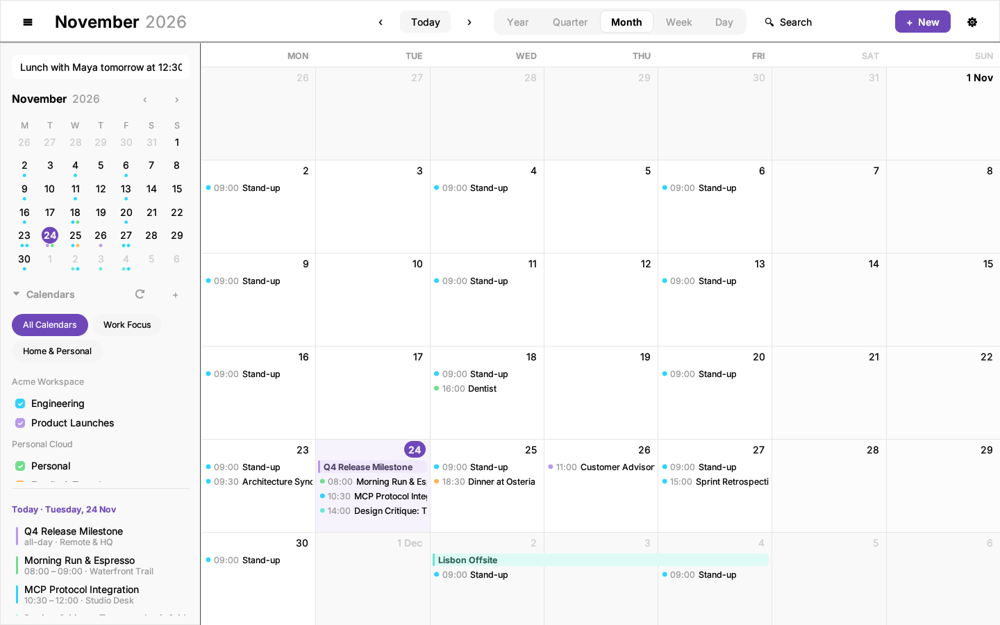
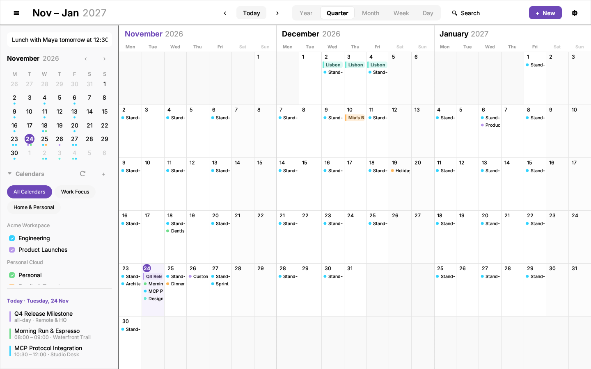
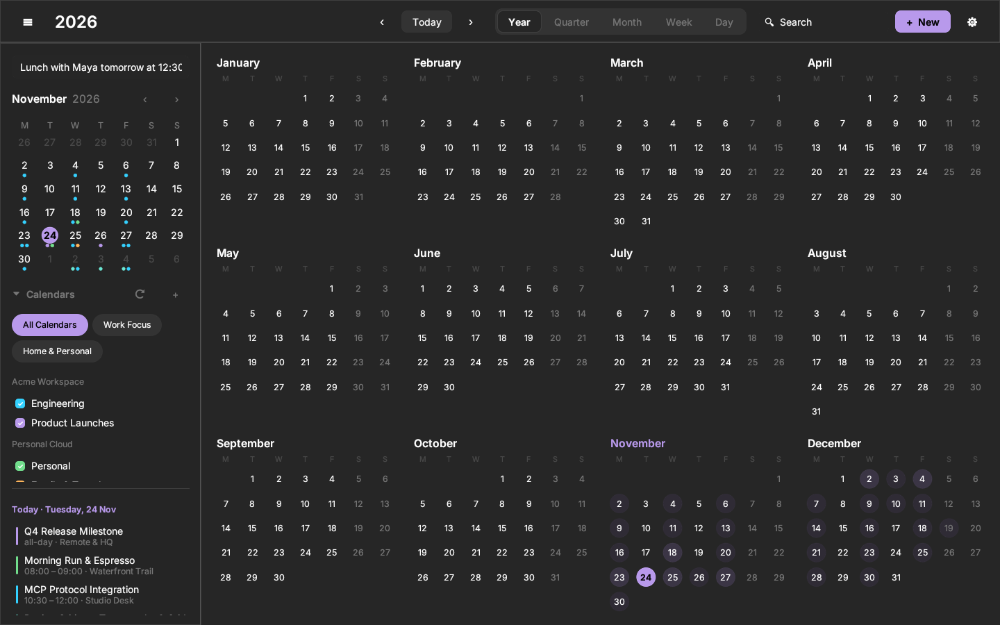
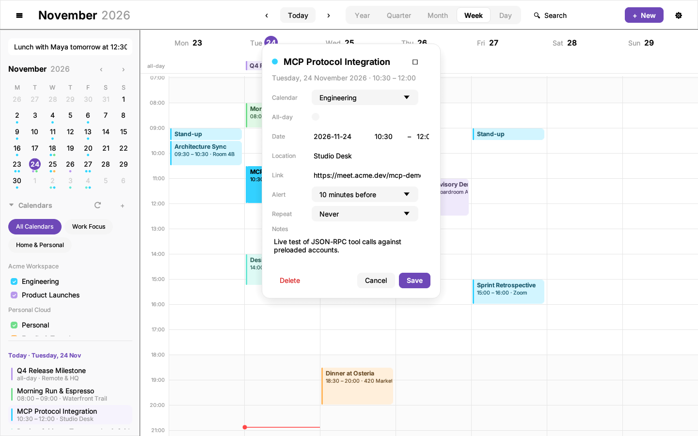
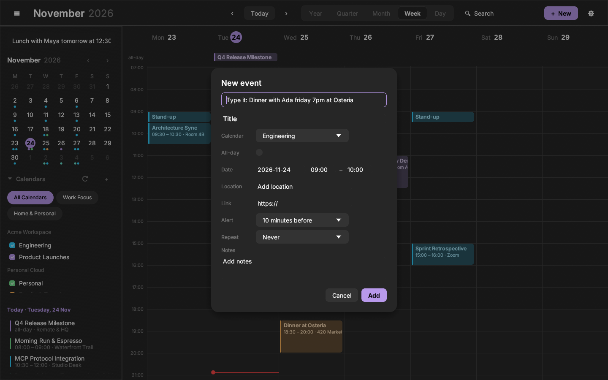

# CalendarCraft

A Fantastical-style calendar written in Rust (egui), for the desktop and the browser
(WebAssembly). It reads and writes CalDAV accounts and `.ics` files, subscribes to `.ics` feeds,
understands sentences ("Dinner with Ada friday 7pm at Osteria"), and runs inside
[artcraftCloud](https://github.com/gheiler/artcraft-cloud) as a Crafting App.



| | |
|---|---|
|  |  |
|  |  |

## What it does

- **Views:** Day, Week, Month, a three-month Quarter and Year. Month and Quarter use one grid with
  shared 1 px borders; multi-day and all-day events are bars across the week; the Year grid is
  aligned month by month and tinted by how busy each day is.
- **Sidebar:** a sentence box with a live preview, a full-width mini calendar with one or two dots
  per day (in the colours of that day's calendars), calendar sets and calendars, and an agenda that
  scrolls with the calendar both ways (scroll the agenda and the day at the top is selected; pick a
  day anywhere and the agenda scrolls to it).
- **Events:** click an event for a popover inspector (calendar, all-day, date and times, location,
  link, alert, repeat, notes, delete); double-click an empty slot or day, press **N** (or **C**, or
  ⌘N in the desktop app) for the new-event dialog. Sentences fill in the dialog as you type.
- **Phone layout** below 720 px: Day and Month, a week strip, swipe sideways to change month.
- **Look:** SnowUI light and dark (purple `#B899EB`, `#6E48B8` for text and filled buttons),
  system typography (SF Pro on macOS, Inter in the browser), roomy buttons (16 × 7 px padding,
  32 px high), follows the system theme unless set.
- **Languages:** English, Deutsch, Español, Français, Italiano, Português (Brasil).
- **Accounts:** CalDAV (iCloud, Fastmail, Nextcloud, Stalwart, any RFC 4791 server), `.ics` feeds
  (read only), local calendars, and `.ics` files. See [docs/accounts.md](docs/accounts.md).
- **MCP server** (`calendarcraft --mcp` or `calendarcraft-mcp`): list, create and parse events
  for an agent.

## Build and run

```sh
cargo run --release                       # desktop app
cargo run --release -- --view quarter --theme dark --date 2026-11-24
cargo run --release -- --demo --screenshot shot.png --size 1440x900   # draws, saves, exits
cargo test                                # unit + integration tests
trunk serve                               # browser build on http://127.0.0.1:8095
sh scripts/package-web.sh                 # dist-release/calendarcraft-web-<version>.zip + SHA256SUMS.txt
```

The browser build takes `?view=`, `?theme=`, `?date=`, `?lang=`, `?demo=1` (sample calendars),
`?open=<event id>` and `?new=1`. `scripts/screenshots.cjs` takes the screenshots above from a
served build (puppeteer-core and Chrome).

A live CalDAV round trip: `CALDAV_TEST_URL=https://server/dav/cal/me/ CALDAV_TEST_USER=…
CALDAV_TEST_PASS=… cargo test --test caldav_live`.

## Where data lives

| | desktop | browser |
|---|---|---|
| options | `~/Library/Application Support/CalendarCraft/calendarcraft.ui.json` | `localStorage["calendarcraft.ui"]` |
| accounts, local calendars | `…/calendarcraft.store.json` | `calendarcraft.store` |
| account passwords | `…/calendarcraft.secrets.json` (mode 0600) | `calendarcraft.secrets` (this browser only) |
| copy of server events | `…/calendarcraft.cache.json` | `calendarcraft.cache` |

`CALENDARCRAFT_HOME` moves the desktop folder. `--config <file>` still loads a preloaded store.

## In a host (artcraftCloud and other Craft hosts)

CalendarCraft's browser build speaks the `craft-web-host` contract when framed with
`?host=parent`: it posts `calendarcraft:ready`, opens what `calendarcraft:open {name, bytes}`
hands it (an `.ics` file shows as its own calendar), and sends `calendarcraft:save` and
`calendarcraft:dirty`. The page API is `window.calendarcraft.execute(command, args)` with
`file.save`, `sync.refresh`, `view.today`, `event.new` and `calendar.subscribe {url, name}`;
`window.calendarcraft.state` is a JSON snapshot of the calendars and the events around the
selected day.

A host can name accounts before the app starts:

```js
window.calendarcraftHost = {
  accounts: [{ id: "artcraft", name: "artcraftCloud", email: "ada@example.org", url: "/caldav/ada%40example.org/" }],
  remoteProxy: "/api/calendar/remote",   // same-origin proxy for other servers (x-calendar-url, x-calendar-auth)
};
```

Host accounts are same-origin and signed by the host (cookie); CalendarCraft never sees their
password. How artcraftCloud does it: [docs/caldav.md](docs/caldav.md).

## Known limits

- Times with a `TZID` are read as local wall-clock time; UTC times are converted. Events are
  written in UTC.
- Properties CalendarCraft doesn't show (attendee status, attachments, `X-` properties) are not
  kept when it writes an event back. A resource holding several events (a recurring series with
  exceptions) is shown read-only.
- Google Calendar has no password sign-in for CalDAV (OAuth only): use its secret iCal address.
- Microsoft 365 / Outlook.com has no CalDAV: publish the calendar and subscribe to its ICS link.
- Account passwords for other servers stay on the device (file or `localStorage`), never uploaded.

Upstream needs (ArtCraft host contract, egui) are in [docs/upstream-needs.md](docs/upstream-needs.md).

Fonts: Inter (SIL OFL 1.1, `assets/fonts/Inter-LICENSE.txt`), subset.
